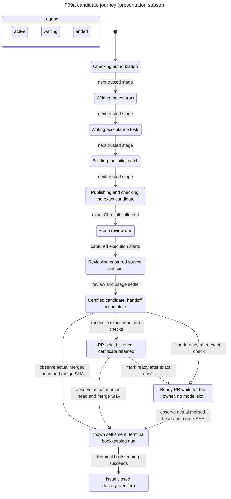

# Bounded factory state models

The F10-4 model covers published-PR feedback repair and owner-head recertification. Its runtime basis is merged F10-2 at `484a6ab`; owner paths follow the settled F10 design, sections 3.6, 3.7 and 6.1. F10-3 is not on that base. Two owner-path correspondence tests are explicitly skipped until it merges; model reachability is not runtime qualification of that unmerged implementation.

On 2026-11-08, **tla-ts 0.0.8** completed F1 structural and F2 feedback with all configured properties holding and empty queues. All four F3 reachability witnesses failed their deliberately false invariants with traces and exit 12. F4 passed 38 runtime tests, with two F10-3 cases pending. No safety counterexample was found. Unrestricted accounting, substantive controller checking and composition of faults remain incomplete. These bounded checks are not a proof of the whole factory or permission to merge a PR.

`Journey.tla` describes the shared `handoffCandidate` policy. `Controller.tla` instantiates Journey and adds claim persistence, external effects, captured callbacks, one restart and conditional validation-ref cleanup. It does not introduce another runtime candidate policy. Its legacy property name `NoPostPrRepair` now delegates to the five F10 replacement invariants, not the obsolete prohibition. `journey/Chart.cfg` also needed the replacement property list to keep the presentation check runnable.

## Bounds and domains

All substantive configurations retain **6 total generations, 2 shared repairs, 3 run-wide refreshes and 3 issued review attempts per repair round**. A generation number is `0..3` within its round. The separate sequence index identifies one of the six retained entries. Early stages are a coarse prefix; their retry-5 behavior is checked by the actual runtime tests, not the structural partition.

| Coordinate | Finite model domain |
| --- | --- |
| Original repair base and admitted instruction pin | Separate named coordinates, both symbol `0` at admission |
| Certified source/main | `0..4`, including a fourth movement that must be refused |
| Factory candidate head and captured generation | Sequence identity `1..6`; owner heads map to `99` without changing the generation index |
| Certification identity | Stored tuple of generation, execution, attempt, source, workflow pin, candidate, patch, CI, gate, acceptance and original base |
| Owner head | One symbolic head `99`, eligible for recertification only in `feedback`; additional owner pushes are not modeled |
| Actual merge commit | Distinct symbol `100 + mergedHead`, never the head itself |
| Observed account tokens | `0..UsageClass`, with `UsageClass = 1`; known and unknown are distinct |
| Prior-stage usage | `PriorUsage = 1` |
| Submitted and consumed owner reviews | `env.feedbacks` and `b.batches`, each `0..2` |
| Repair cause and merge authorship | `none / ci / review / feedback` and `none / factory / owner`; every generation has an `owner` bit |
| Abstract review/repair/run quotas | `3 / 3 / 8` |
| Restarts | At most one in the controller check |
| Cleanup partition | One fixed `focus` generation chosen from `1..6` per behavior; all six identities are explored |

The accounting partition explores an exact certification tuple and each single-coordinate mismatch class. A mismatched tuple cannot certify the current generation. Workflow SHA/digest are one pinned identity class; cryptographic hashes and malformed wire types remain runtime boundaries.

The abstract quotas are not replacements for the unchanged real limits of **120,000 review tokens per round, 300,000 repair-build tokens per round and 800,000 run tokens**. There is no claim of linear scaling or a proof for all real amounts. Actual reducer tests check cap−1, cap and cap+1 at each real limit, cumulative attempts, prior-stage spend, duplicate/lower/unknown late results and oversized final receipts. Oversized usage is retained; it does not authorize another launch. Monetary accounting is not proved.

### Explicit partitions

The `Profile` constant selects a partition of the same model, not smaller structural constants.

- `structural`, in `journey/Journey.cfg`, permits CI-triggered repairs, successful repair builds, review success/failure and main movement during validation, review issuance, waiting or stopping. It excludes unknown usage, launch unavailability, switch/capacity changes, owner-head drift and blocking-review-triggered repair. It reaches all six generations.
- `feedback`, in `journey/Feedback.cfg`, retains 6/2/3/3 and quotas 3/3/8. CI passes or fails; review passes or blocks; repair builds may fail or make no progress. All usage and stops are known. Main moves only in `waiting` or `held`. Owner reviews, the owner head, merge, close, head convergence and the ordinary check are enabled. Switch/capacity changes, unavailable launches and late receipts are excluded. Only owner feedback can enter a published repair; failed CI/review and no progress hold instead of automatically starting another round. Owner drift is observed before new policy work, recertification selects the exact owner head without a build or promotion, and refresh holds on owner-derived generations. `feedback_no_main` is the same partition with main movement disabled, reserved for the approved single timeout retry; it was not needed or run.
- `accounting` uses the same Journey config with only `Profile` changed. It includes failed/unavailable attempts, blocking reviews, repair retries, unknown settlement and late accounting, but no main movement or switch/head-drift changes. The historical F09a fixed-model check with default `LateUnknown = TRUE` timed out with an unfinished queue. Its completed `LateUnknown = FALSE` check covered known late receipts and unknown current settlements only; it did not cover duplicate unknown old receipts, and neither check was rerun for F10-4.
- `late` is a diagnostic partition with successful CI and nonblocking known review results, main movement and both known/unknown late receipts. Its historical F09a fixed-model check completed with all configured properties holding; it was not rerun for F10-4. It excludes unavailable launches and switch/head drift; it is not a combined proof.
- `transport`, in `controller/Controller.cfg`, includes successful or failed CI, successful repair builds, refresh, switch holds, owner head/merge/close, head lag, persistence, orphan stop and private-evidence loss. Review output is nonblocking; review/stop usage may still be unknown. It retains the six-entry path but excludes blocking-review repair, unavailable launches and failed repair-build retries.
- `CleanupPartition = TRUE` checks one representative generation's ref/deadline/owned cleanup per behavior. `focus` is chosen across all six identities and stays fixed. Other generations still take the shared candidate transitions, but their external ref/deadline substeps are abstracted. **Concurrent all-ref cleanup interleavings are unproved.** Setting it to FALSE represents the full ref cross-product; its exploratory check was stopped for growth, not accepted as a pass.
- `combined` enables the pre-F10 unpartitioned alternatives, not feedback intake or owner recertification. Its historical exploratory run was stopped for state-space growth. **Composition of all faults, including F10 with accounting/transport faults, is unproved.** Partition passes must not be called a full combined protocol proof.

No state-space constraint silently removes a seventh generation or a fourth issued review. Those refusals come from the policy. The actual six-entry runtime witness is `(r0,g0), (r1,g0), (r2,g0), (r2,g1), (r2,g2), (r2,g3)`. It uses only two repair executions before the final review, not an invented fourth review attempt.

## Checked properties

The configs are the exact property lists. These names replace the old F08 promises openly.

| Properties | Contract |
| --- | --- |
| `TypeOK`, `BookBounded`, `ExactBinding` | Legal finite domains, unchanged structural ceilings and captured generation/source/pin identity. |
| `ReviewOnlyValidated`, `CertificateSound`, `CertificationNeedsKnownSettlement`, `ReadyHasCertificate` | Review follows exact CI; certification is created from a known settled receipt and retains its immutable identity. Later accounting uncertainty does not erase historical certification. Historical certification is not current readiness. |
| `HandoffDecisionExact`, `PromotionDecisionExact` | At the observation that chooses the effect, readiness uses the current certified head and ordinary check; promotion starts from the expected predecessor. These are not omniscient assertions about later GitHub changes. |
| `MergeAssuranceTruthful`, `MergeAuthorTruthful` | Record the actual head and distinct merge commit. Matching historical certification gives `factory_verified`; an unmatched head gives `owner_override`. A verified owner head records owner authorship, including a merge before readiness. |
| `FinishOnlyAfterSettlement` | A stop completion that emits `finish_pr` must have reconciled every account. It holds in the completed fixed-model Journey partitions; unrestricted accounting remains incomplete. |
| `NoLiveTerminal`, `OneExecution`, `WaitingSlotFree` | No issued/running execution at termination, at most one issued/running execution and slot-free waiting. Uncertain cost is distinct from a live execution. |
| `PostPrRepairOnlyFeedback`, `PostPrRepairNotReady` | Published repair phases require an owner-feedback cause and withdrawn readiness. These replace `NoPostPrRepair`. |
| `NoOwnerAuthoredRepair`, `NoFactoryCommitOnOwnerHead` | No repair of an owner-derived current or promoted generation, and no factory successor/refresh whose expected predecessor is the owner head. |
| `AllowanceWithinRemaining`, `NoFreshBudget`, `HistoryImmutable`, `UsageMonotonic`, `IssuedMonotonic` | Derived allowances, retained prior usage, immutable archives and monotonic account/attempt history. |
| `EffectHasDurableIntent`, `ProcessHasAccount`, `OneSandbox`, `NoTerminalProcess` | The controller persists before external work, binds the process to a saved account and never finalizes a live process. One process is represented explicitly; launch guards prevent another owner from reusing it. |
| `MissingGrantsNoWork`, `CleanupOwnedOnly`, `DeadlineNeverReset` | Missing private evidence grants no work; moved validation refs are preserved; generation deadlines never restart. |
| `SavedUsageMonotonic`, `SavedAttemptsMonotonic`, `SavedHistoryImmutable` | Atomic saved books retain their floors and archives across the modeled restart. |
| `ObservedMergeSettles` | An observed merge with known settled accounts and no live process eventually finishes, or visibly blocks on lost private evidence, under the scheduling/read assumptions below. |

The old `LandOnlyVerified` promise is false because an owner can merge an uncertified head. The replacement reports assurance honestly. The old instantaneous `MergeEndsRun` is replaced by observation, stop/account settlement and terminal bookkeeping. Clean review now leads to nonterminal waiting, not terminal `stage_passed`. Successful CI does not require an eventual owner merge.

### Fairness and proof limits

Journey has no fairness assumptions. Controller weak fairness covers `Persist`, `OtherResponse`, `RecoverStop`, `Recover`, `Decide` and `ObserveTerminal`. This assumes scheduled controller ticks and eventually successful required claim writes, owned-process reconciliation and response reads/effects when they remain enabled. The progress property starts after known settlement. It does not prove a permanently unresponsive process will stop or that unknown spend becomes known.

There is no fairness for owner merge, successful review, switch re-enable, capacity becoming free or restoration of private evidence. Missing-book PR observation remains visible, but cannot finalize without private accounting/certification. Private recovery represents a validated saved intent, not reconstruction from GitHub. Repeated arbitrary crashes are outside the one-restart bound.

Controller-only properties remain unproved because its substantive exploration timed out. The preceding revision's incomplete exploration is not proof for the fixed Journey model. Cleanup is modeled per representative generation, not for every combination of all retired refs and restarts. The real all-generation sweeper tests remain required. Only one issue is modeled. The real Orchestrator test `waiting uses no slot while two other issues enter execution` retains capacity-2 coverage. Git object bytes, ordered parents, seat/risk schemas, full manifest parsing, marker size, filesystem atomicity and native Actions identity checks require runtime tests and separate qualification. Symbolic candidate identity denotes the final ordered-parent candidate prepared before CI; TLC does not implement Git hashing.

Effect completion represents an exactly matching domain request. Full JSON request equality and malformed/stale transport payload rejection remain runtime boundaries, not a formal parser proof. Promotion is a read, then `force:false`, then reread. It is **not expected-head CAS**. The controller model permits a different ancestor between the read and write, but refuses an unexpected nonancestor. Ref and API PR head are separate; the ordinary PR check follows promotion.

A manually conflicting authenticated public marker can report 500001 tokens while a saved private book reports 40, and warm recovery accepts 40. This is not a demonstrated normal-write crash. A separate probe changes the land-stage projected attempt to 3 while `reviewAttempts` remains `[1,0,0]`; it does not show rollback from three issued reviews. Five separate-process crash windows preserve coherent usage and issued attempts. They do not prove power-loss durability, backup recovery or refusal of manually conflicting input. No recovery-floor policy change or model-only refusal was added.

### Stop-to-finish repair

Before the repair, accounting and late diagnostic traces failed `FinishOnlyAfterSettlement` with exit 13. The retained 14- and 19-state traces exercise the exported reducer and public `advance`. At the fixed revision, all 9 and 14 candidate-state comparisons before the unsafe final step still match. The final step diverges safely: the old trace expects `finish_pr`, but the reducer requests another `stop_execution`. The accounting trace retains an uncertain review account; the late trace retains an issued review account. A known receipt drains the remaining account before terminal bookkeeping.

`complete(stop_execution)` now calls the existing `finish(updated, terminal)` helper after settling its captured account. The helper selects another unsettled account instead of finishing unconditionally. Seven strict-TypeScript regressions cover a newer running or uncertain review, owner override, closed PR, authorization withdrawal, release and failure. They check exact requests, codec acceptance, usage floors, stale completions and retained terminal metadata. Failed or unknown stops cannot finalize. The corrected pre-fix run fails all seven at the missing next stop; the initial below-floor test draft remains diagnostic history, not the red proof. The standalone newer-running-review probe also passes after the repair. The generic trace decoder is runtime diagnostic evidence, not strict-TypeScript evidence.

These are public-policy regressions, not a reproduced production duplicate-callback incident. Six actual Orchestrator controls exclude the supplied duplicate history under the single serial controller, native Promise and coherent-private-state assumptions. Fifteen process invocations cover setup, abrupt exit and recovery at five boundaries. Four recover at usage 40 without another executor invocation. A saved attempt-2 intent resumes with allowance 0, then attempt 3 receives 29989; final usage 51 retains attempts 1/2/3 with charges 11/0/11. A zero-allowance executor invocation is not model work.

The Journey `Stop` decision mirrors helper reuse without adding a source-absent `Drained` guard to `FinishPr`. The late partition now completes, but the unrestricted accounting timeout still prevents full accounting qualification.

## Source correspondence

| Model actions/operators | Source at the sync commit |
| --- | --- |
| `Gen`, `Select`, `Issue`, `CanIssue`, `Account`, `Usage` | `src/handoff.ts`: `generationIntent`, `selectGeneration`, `issueExecution`, `preflight`, `updateAccount`, `candidateUsage` |
| `ReviewResult`, `Validate`, `FailOrRepair` | `handoffCandidate`, `complete`, `certifyGeneration`; full review/report validation is a boundary assumption backed by runtime tests |
| `Refresh`, `Handoff`, `ObserveMerge`, `Finish`, `Stop`, `FinishPr` | `src/handoff.ts`: `observed`, `terminalFor`, `finish`, `complete` |
| `OwnerFeedback`, `FeedbackRepair`, `SettleRepair` | Merged F10-2: `ingest`, `startQueuedFeedback`, `repair_settled` and `stopRound`. The model abstracts batch bytes, intake notices and summaries to a submitted/consumed counter; permission, head binding, dismissal, cursor durability, launch floors and dispositions remain runtime boundaries. |
| `OwnerDrift`, `OwnerRecert`, `HeadOf`, merge `authored` | Settled F10-3 design, not merged F10-2 implementation. Derivation success and its clean tree/suite binding are abstracted; derivation refusals, forbidden paths, the pin ref, no-commit interpreter behavior and v5 ledger authorship need F10-3 runtime tests. `OwnerCertifiedCurrent` denotes the selected owner head, even before certification, so validation/review can finish without re-entering drift. |
| Shared public policy | `src/stages.ts`: `advance`; it delegates candidate events to `handoffCandidate` |
| `Decide`, `Persist`, effect/response separation | `src/orchestrator.ts`: `#observeCandidates`, `#commitCandidate`, `#interpretCandidate` |
| Process/captured callback/recovery actions | `#launchCandidate`, `#recoverCandidate`; callbacks capture their execution, and a new Orchestrator starts with an empty volatile result queue |
| Remote open/promotion and head lag | `server/controller.ts`: `controllerCandidatePort`; `src/publication.ts`: `GitHubPublicationApi.promotePr` |
| Fixed deadline and cleanup | `controllerValidator`, `sweepValidation`, `cleanupPublication`; original archived evidence is not rewritten |

Accounting records distinguish issued/running ownership from uncertain final cost. Historical certificates are checked at creation rather than being erased when a later receipt becomes uncertain. A stop request has a `stopping` phase, not slot-free `waiting`; `candidateProjection` reports such work as running. These source-correspondence rules and the specific stop-to-finish repair do not substitute for unfinished accounting exploration. A pending finish after a queued callback alone is not proof of an unsafe external write: the actual Orchestrator observes again after consuming callbacks. Its stop-completion recursion is the boundary targeted here.

The earlier controller counterexample retained a volatile callback across a crash, then used it to certify a resumed live process. That step cannot occur in a new Orchestrator: `#candidateResults` is initialized per instance. The model was corrected to discard that queue on `Crash`; `NoTerminalProcess` was not weakened. No runtime bug is claimed from that trace.

## F10-4 results (2026-11-08)

Checker **tla-ts 0.0.8**, Node **26.13.0**, eight workers, fingerprint polynomial `0`, 24,000 MiB Node old-space ceiling. The owner approved this checker after its baseline probe reproduced Java TLC's 1,670,069 structural states. No Java checker was used for F10-4. The commands are below; wall times are `/usr/bin/time` measurements, not the checker's rounded clock. Every completed qualification run used the following model/config hashes; the semantic-error preflight predates the quantifier fix.

| File | SHA-256 |
| --- | --- |
| `journey/Journey.tla` | `2cf79b05731caf5196b03b31de64a1efadc5c4ece0ffa03db7bee54309d7892b` |
| `journey/Journey.cfg` | `b0bd3dfc132d1eadaaa2def23576e76638bd519bf17593101edbf75b97ffe64f` |
| `journey/Feedback.cfg` | `b07e6e16497c1630f74c549da07acb4af35f5d70f9752a8812b8737d5d91ce9f` |
| `journey/PublishedRepairWitness.cfg` | `a7fcacaad4c12a4c48f4c61b531191cf8ca532ac6b6daabc827eb6ef58e9f8c0` |
| `journey/OwnerReadyWitness.cfg` | `a4ff583a5df053551b27d79492b7ca015a21c0108a5e7a908938282f6b1e10e8` |
| `journey/MergeMidRepairWitness.cfg` | `f257d8eb6eb3c656f3c09feec5d74bb91f0104bf8536227680c63384f7b7f6ce` |
| `journey/OwnerAuthoredMergeWitness.cfg` | `104babc250c7d1168b132c770c4b4608f4a9e0b8c66326775e24ce77bac12818` |
| `journey/Chart.cfg` | `d6bff8a9ff7154923e971f214638b8b68854e6ca268a0c499366685938bdb783` |
| `controller/Controller.tla` | `498fe16f509c1b8bb23e1988c056bb49414e877f703993c81538ae4a0b65a5a6` |
| `controller/Chart.cfg` | `aedbc63300b06b9f1a4650efad5bb8c1794343fcc307d77d2c44106993fd8f0f` |

| Run and config | Bound | Wall seconds | Distinct states | Queued | Exit and result |
| --- | ---: | ---: | ---: | ---: | --- |
| Development F1 `Journey.cfg` (before quantifier fix) | 1200 s | 0.20 | not reported | not reported | 150, semantic error before initialization; not run |
| F1 `Journey.cfg` | 1200 s | 12.11 | 1,670,069 | 0 | 0, all configured invariants/action properties hold |
| F2 `Feedback.cfg` | 1800 s | 456.00 | 69,051,765 | 0 | 0, all configured invariants/action properties hold |
| F3 `PublishedRepairWitness.cfg` | 300 s | 0.50 | 614 | 244 | 12, `NoPublishedRepairWitness` violated; 18-state trace |
| F3 `OwnerReadyWitness.cfg` | 300 s | 0.60 | 9,188 | 3,316 | 12, `NoOwnerReadyWitness` violated; 23-state trace |
| F3 `MergeMidRepairWitness.cfg` | 300 s | 0.50 | 628 | 255 | 12, `NoMergeMidRepairWitness` violated; 18-state trace |
| F3 `OwnerAuthoredMergeWitness.cfg` | 300 s | 0.60 | 5,869 | 2,186 | 12, `NoOwnerAuthoredMergeWitness` violated; 22-state trace |
| Journey `Chart.cfg` | 300 s | 0.40 | 42 | 0 | 0, presentation only |
| Controller `Chart.cfg`, colocated Journey | 300 s | 0.30 | 281 | 0 | 0, semantic processing and presentation, including temporal properties |

F2 finished, so **no narrower retry ran**. Its delivery contract was approved on 2026-11-07: a timeout is incomplete, not a pass, and permits one 1800-second retry without main movement. Any safety counterexample blocks. F1 and F3 are required regardless. A `TlaUnsupportedError` is **not run**, never a pass. The first development F1 invocation failed semantic processing (exit 150, 0.20 s, no state counts reported): two nested quantifiers reused `i`. Parenthesizing the first quantifier fixed the model; the F1 row above is the subsequent clean run. This was not a product counterexample.

The witness configs use exactly Feedback's constants and **only their named invariant**, with no property list or state constraint. Their queues need not drain: exit 12 and the intended violation are the required outcomes. The shortest traces are:

- **Published repair (18 states):** early prefix → validate → fresh review → certificate → open the PR → hold on the missing ordinary check → owner review → feedback `repair_due` → issue → `repairing`, with readiness false and cause `feedback`.
- **Owner ready (23 states):** the same certified/open prefix → owner ref `99` → `owner_due` → head convergence → select an owner generation → exact CI → fresh review → certificate on `99` → ordinary check → complete handoff, ready on the owner head. No repair build or promotion occurs.
- **Merge mid-repair (18 states):** the published/held prefix → owner review → feedback `repair_due` → owner merges the old certified head before a build is issued → observed merge, `factory_verified`, authored `factory`, readiness false. F4 also checks the longer path with a live build, stop, charge and terminal completion.
- **Owner-authored merge (22 states):** the owner selection/CI/review prefix → owner merges `99` immediately after certification, before readiness → observed merge, `factory_verified`, authored `owner`. It does not depend on the owner-ready witness.

F4's TAP selection passed **38 of 40 tests, zero failures, two explicit F10-3 skips**. Three new active replays check published repair, the shortest merge-before-launch trace and the longer stop/charge trace through both `handoffCandidate` and public `advance`. The owner-ready and owner-authored merge design replays are pending because their reducer paths are not in `484a6ab`; enable and bind their wire fixtures after F10-3 merges. Runtime tests expand the model's abstract review event into durable batch/notice steps and its numeric token classes into the real cumulative accounting. They are named correspondence replays, not a generic trace decoder. The F3 traces themselves were inspected for the states above.

`TMPDIR=/home/g/.cache/f10-4-tmp FACTORY_REQUIRE_SANDBOX_TESTS=1 npm run check` passed: **2,315 passed, 2 skipped, 2,317 total**, zero failures. The two skips are only the F10-3 design cases. No product code was changed; no VM or model calls were used. The plan was unchanged.

Local logs and full traces are retained in `/home/g/.cache/f10-4-tmp/formal/`, with the final project gate in `/home/g/.cache/f10-4-tmp/check-final.log`. These are local evidence, not shipped artifacts.

| Log | SHA-256 |
| --- | --- |
| `F1-v2.log` | `968e188e6412a0c228175bd2354e27ffeac5cb40789f56c031723574c1843072` |
| `F2.log` | `b52581392a966e4aa8d559776a7ab947097fe35b3a9213c51c3374c86b7665a5` |
| `F3-PublishedRepair.log` | `82220fd27669774c246587a20104b9c00459e0f70cec849bbad0e4b844c6bbf7` |
| `F3-OwnerReady.log` | `be34acb70340d18ff05d956828dc6637a58d99d0d1dc341744cb859e2d3fd21c` |
| `F3-MergeMidRepair.log` | `89384f5f77fed6b917a639fd72f2c234c650d0c7a2fe75cceb7be97c4b7b3624` |
| `F3-OwnerAuthoredMerge.log` | `026ef56fe5120f767ac960427c5298404b67613d992fd2490ddc1ac91f528f7b` |
| `journey-chart.log` | `a174196a122ff0581dd0d15f3626b518f05caf232a90984de646d30769d3758c` |
| `controller-chart.log` | `debb6b8a65f80504b33f5256f455412f25a23099b91d2cf4a6499a110f2cdf13` |
| `F4-final.tap` | `9fed0ed0ebd06cb7ccd8c62e490c6d9a45f48169e8584cb429b7fb759bfb19cb` |
| `../check-final.log` | `4b53f5f5f3ef7b26951c6445471f33ca481f5dbdb4ec0a2eed12d7f658d79d9a` |

### Historical F09a results (not rerun for F10-4)

The following results cover repair commit `6571ed76db1ce0b721f9fefe6ecae70a07369ac4`, not the F10 model. TLC `2026.10.28.014557`, Temurin Java `21.0.13`, fingerprint polynomial `0`. Structural, accounting and late checks use four workers, known-late accounting uses eight, the controller uses four, and presentation checks use one. The model/config identities of these runs are SHA-256 values, separate from the runtime sync commit:

| File | SHA-256 |
| --- | --- |
| `journey/Journey.tla` | `5d11a4babaf875870b06ccc6e0b4005772f584f8d77a046a91c6d09d6a1b85e3` |
| `journey/Journey.cfg` | `f879e9902176b583becf6fcf9954c2ce3a463f851830b573d440cae5088a36ad` |
| `controller/Controller.tla` | `352119fe3afedc087573f0e44cf2031ed1d003c19f417dae538f0a04eab337bc` |
| `controller/Controller.cfg` | `ddc0cae91effbed82a890574c14f24b6af9abd5822532ea29465fb746b326bae` |

| Check | Distinct states | Outcome |
| --- | ---: | --- |
| Journey structural, full 6/2/3/3 | 1,670,069 | All configured properties hold |
| Journey accounting, known-late-only partition, same bounds | 4,568,906 | All configured properties hold; excludes duplicate unknown old receipts |
| Journey accounting, duplicate unknown receipts included | 25,985,320 last reported | Incomplete; 1200-second timeout, exit 143, 9,393,542 states still queued |
| Journey late diagnostic | 725,100 | All configured properties hold |
| Controller transport, same structural bounds, one restart | 45,845,161 last reported | Incomplete; 1800-second timeout, exit 143, 5,995,544 states still queued; no model or temporal completion |
| Journey presentation | 42 | All configured properties hold |
| Controller presentation | 281 | All configured properties hold |

Both timeouts are incomplete, not passes or reported counterexamples. The final native Controller result, collected on 2026-11-01 at 06:09 UTC, supersedes the earlier pending snapshot. Its command, model, config, and log hashes match the retained run. The original author started that 1800-second job despite the prerequisite-green order; that workflow deviation does not qualify accounting or controller properties. No replacement heavy check was started for this documentation update. Completed presentation checks cannot substitute for either substantive check.

The presentation configs select a successful single-generation path with no refresh or restart and fix cleanup focus to generation 1. They are **not substantive proofs**, despite retaining the same ceiling constants. The diagrams come from their actual reachable graphs. The views hide no action explicitly; the renderer omits stuttering and transitions within the same displayed label. The full graphs exceed the renderer's 500-state budget and are not presented as these small diagrams.

The runtime correspondence entry point is a named-test runner, not a generic TLC decoder:

```sh
node --experimental-strip-types docs/statecharts/journey/replay-merge-mid-repair.ts
```

It now requires at least 40 selected tests and 38 passes, including the three active F10 replays, six-generation, real Orchestrator restart and actual promotion cases. The historical F09a fixed-revision selection ran 33 tests, including the seven terminal-drain regressions. At the preceding revision, a six-entry TLC witness matched 14 actual intermediate candidate states through the exported reducer and public `advance`. Five isolated TypeScript mutations failed behavior assertions: reset attempts on refresh, accept a stale generation, lower a usage floor, finish before stop and promote from an unexpected predecessor. Restoration passed. Those retained receipts are not new fixed-model trace or mutation qualification. Unchanged TLC alone is not evidence against mutated TypeScript.

The final project gate includes all existing runtime tests. Formal checks, this runner and view compilation are separate from `npm run check`. Independent formal review, Comment Sicko, the complete crash/manifest/maximal-marker matrix, operator/rollout documentation, main-backed reporter bootstrap/P4, production protection, real owner actions and live/performance qualification remain separate gates. No full-feature or merge-ready verdict is implied.

## Presentation diagram

The matching standalone diagrams are [`journey/chart.mmd`](journey/chart.mmd) and [`controller/chart.mmd`](controller/chart.mmd).



## Reproduce the checks

Use the installed **tla-ts 0.0.8** CLI directly. Java is not installed or needed. This avoids the historical statechart wrapper's Node/SANY-XML-reader failures without altering any shared package. The CLI performs parsing and semantic processing itself. A semantic/unsupported error is not a completed check.

The following expands the exact qualification command for every row above. Each `run` records version (in the log header), command, exit, wall time, distinct states and queue. Keep the logs, timing files and SHA-256 hashes. Witness runs expect exit **12**, not zero.

```sh
set -eu
CHECKER=/home/g/.pi/agent/npm/node_modules/tla-ts/dist/cli.js
J=docs/statecharts/journey
C=docs/statecharts/controller
OUT=$(mktemp -d)
run() {
  name=$1 seconds=$2 spec=$3 cfg=$4 expected=$5
  printf 'timeout %s node --max-old-space-size=24000 %s %s -config %s -workers 8 -fp 0\n' \
    "$seconds" "$CHECKER" "$spec" "$cfg" > "$OUT/$name.command"
  status=0
  /usr/bin/time -f 'wall_seconds=%e\nmax_rss_kb=%M' -o "$OUT/$name.time" \
    timeout "$seconds" node --max-old-space-size=24000 "$CHECKER" "$spec" \
    -config "$cfg" -workers 8 -fp 0 > "$OUT/$name.log" 2>&1 || status=$?
  printf '%s exit=%s\n' "$name" "$status"
  grep -E 'Version|distinct states found|Error:|Invariant .*violated' "$OUT/$name.log" || true
  test "$status" -eq "$expected"
}
run F1 1200 "$J/Journey.tla" "$J/Journey.cfg" 0
run F2 1800 "$J/Journey.tla" "$J/Feedback.cfg" 0
for witness in PublishedRepair OwnerReady MergeMidRepair OwnerAuthoredMerge; do
  run "F3-$witness" 300 "$J/Journey.tla" "$J/${witness}Witness.cfg" 12
  grep "Invariant No${witness}Witness is violated" "$OUT/F3-$witness.log"
done
run journey-chart 300 "$J/Journey.tla" "$J/Chart.cfg" 0
# Controller instantiates Journey: copy both modules together.
cp "$J/Journey.tla" "$C/Controller.tla" "$OUT/"
cp "$C/Chart.cfg" "$OUT/ControllerChart.cfg"
run controller-chart 300 "$OUT/Controller.tla" "$OUT/ControllerChart.cfg" 0
node --experimental-strip-types "$J/replay-merge-mid-repair.ts" > "$OUT/F4.tap"
TMPDIR=/home/g/.cache/f10-4-tmp FACTORY_REQUIRE_SANDBOX_TESTS=1 npm run check
```

The shell stops if F2 times out. Only for exit 124, record it as incomplete with the last distinct/queued counts and **every configured invariant and property still unqualified**. The owner-approved contract allows one narrower retry, changing only `Profile = "feedback"` to `Profile = "feedback_no_main"` in a scratch Feedback config, with another 1800-second bound and the same checker/heap/workers/fingerprint. There is no third attempt. A second timeout remains incomplete, not a pass; a counterexample blocks. F1 timeouts and missing/unsupported F3 traces block. Do not rerun the previously incomplete substantive Controller or accounting partitions as part of F10-4.

For an optional presentation graph, use the corresponding `Chart.cfg` and add `-dump dot,actionlabels <output-path>` to the same tla-ts command. The checked-in diagrams remain the F09a presentation subset (42 Journey and 281 Controller states); they do not depict feedback or owner recertification. With `DOT`, `VIEW` and `CHART` set to absolute input/output paths, the installed unchanged DOT renderer can be invoked as follows:

```sh
export P=/home/g/.pi/agent/npm/node_modules/pi-herdr-pstack/skills/statechart/scripts
bun --eval '
const fs = await import("node:fs");
const { pathToFileURL } = await import("node:url");
const { inspect } = await import("node:util");
const load = (file) => import(`${process.env.P}/${file}.ts`);
const { parseDot } = await load("frontends/dot");
const { checkView } = await load("frontends/view");
const { walk } = await load("passes/reach");
const { project } = await load("pipeline");
const { mermaidLines } = await load("backends/mermaid");
const graph = parseDot(fs.readFileSync(process.env.DOT, "utf8"));
if (!graph.states.size || graph.states.size > 500) throw Error("presentation graph bound");
const view = checkView(await import(pathToFileURL(process.env.VIEW).href), inspect);
const { chart } = project(graph, walk(graph), view, []);
fs.writeFileSync(process.env.CHART, mermaidLines(chart).join("\n") + "\n");
'
```

The renderer consumes the checker's DOT output, not a hand-drawn graph. Rendering is separate from qualification; a presentation pass never substitutes for F1 or F2.
