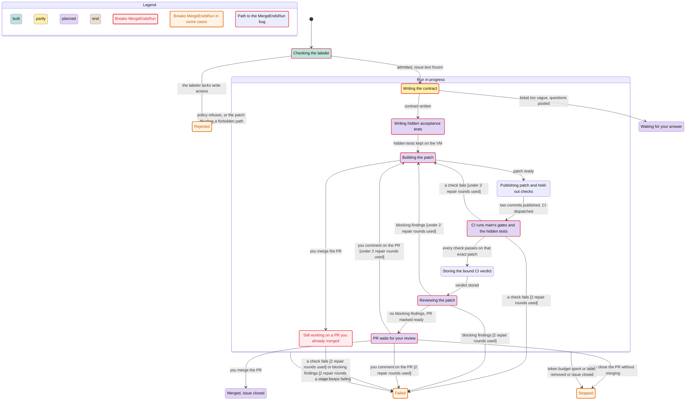

# Factory statecharts

Two checked charts of how a ticket moves through the factory. Each one comes from a TLA+ model that TLC checked, and the chart is drawn from the states TLC reached.

- `journey/` is the full v1 flow, from the label to the merge. It follows `advance()` in `src/stages.ts`, and adds the PR feedback loop that the design and plan step F10 describe. Most of this flow is not built yet.
- `controller/` is what `src/orchestrator.ts` and the sandbox executor do with one run today: claim, launch, retry, release, and recovery after a restart.

## A ticket's journey (v1 design)

Teal is built, yellow is partly built, and purple is still only in the plan. The red state breaks a rule, and the red border marks the path to it.



Rules checked (`journey/Journey.cfg`):

| Rule | Meaning | Result |
| --- | --- | --- |
| `LandOnlyVerified` | Nothing is recorded as landed unless every check passed on that exact patch. | holds |
| `RepairCap` | A ticket gets at most two repair rounds, reviewer and owner rounds together. | holds |
| `ReviewOnlyVerified` | Review and human review only see a patch whose checks passed. | holds |
| `MergeEndsRun` | Once you merge the PR, the run ends as landed. | **breaks** |

`MergeEndsRun` breaks on this path: the PR waits for your review, you comment, the run goes back to build, and you merge the PR on GitHub while the repair is building. `advance()` accepts `landed` only during `land`, so it returns `invalid`, and the run keeps building on a PR that is already merged. `journey/replay-merge-mid-repair.ts` replays this against the real `advance()`. It uses a blocking review in place of the owner comment, because F10 is not built and both take the same repair path. The F10 plan now turns the PR into a draft during a repair, so GitHub refuses the merge. It keeps the published head and its verdict apart from the repair in progress, so a merge that lands anyway ends the run as landed and records whether that head was verified.

The chart hides some arrows to stay readable. "You merge the PR" is drawn only from "PR waits for your review" and "Building the patch". "You close the PR without merging" is drawn only from "PR waits for your review". The model allows both from every stage after the PR opens.

## What the controller does with one run today

The generated Mermaid diagram is [`controller/chart.mmd`](controller/chart.mmd). Blue is waiting for admission, teal holds a claim and tan has ended. Terminal states distinguish a pending branch deletion from an absent branch.

Rules checked (`controller/Controller.cfg`, which also allows a re-label):

| Rule | Meaning | Result |
| --- | --- | --- |
| `OneSandboxPerIssue` | Two sandboxes never run a stage for one issue at the same time, even across a restart. | holds |
| `EndedStaysEnded` | A run that ended never launches a stage again. | holds |
| `AttemptCap` | A run never gets more attempts at a stage than the workflow allows. | holds |
| `OneLiveRun` | GitHub never shows two live runs for one issue. | holds |
| `NotLost` | After the first tick, a live run on GitHub is held in memory or reserved for adoption. | holds |
| `Adopted` | A reserved run is always adopted or ended later. A restart never loses it. | holds, if the reads adoption needs succeed eventually |
| `CIEnds` | A published CI wait eventually ends and its branch is removed, even after transport failures. | holds under fair deadline, recovery and cleanup steps |

`controller/Chart.cfg` uses one attempt, no re-label and no restart. Its 84 states fit the renderer's 500-state budget. `Controller.cfg` checks two attempts, a re-label and one restart over 8,052 states; all eight rules hold. Publication, CI transport failures, deadlines and verdicts are represented in both. Public marker v2 reports the live CI phases as `running` at validate. Cleanup may remain pending after a terminal marker. `CIEnds` requires eventual deletion under fair successful cleanup, not deletion during a permanent GitHub outage. The model assumes the branch remains controller-owned; a moved head is deliberately preserved by the implementation.

After a restart, the first tick reserves the run from its claim file, and usually adopts it from its marker in the same tick. Adoption waits for a later tick when the issue's marker comments cannot be read, or when the workflow is not loaded. It also waits when the timeline read fails for a run whose marker says running or retrying, and when no slot is free for a claimed or blocked run. Until then the run is reserved but not in memory, which `test/orchestrator.test.ts` also expects. A claimed or blocked run whose timeline read fails is adopted, but it does not relaunch until the read succeeds. The model splits reserve and adopt into two steps, so other events can happen between them, and assumes the reads succeed eventually.

The small chart omits retries and restarts; the full model checks both. The view hides the startup reconcile retry and adoption steps that only end a run whose budget is spent. A restart mid-model-stage counts the interrupted attempt as a failed one. A restart during publication or CI waiting restores that phase without a sandbox or interrupted attempt.

## What the models leave out

- One issue only, so the concurrency cap and slot sharing are not checked.
- Admission refusals, the kill switch, and the sandbox preflight internals. Admission is covered by `test/admission.test.ts`.
- Marker posts that fail or return no comment. The model posts every marker at once.
- Adoption reads that fail indefinitely. CI transport failures are modeled explicitly; adoption still assumes eventual successful reads.
- Timing. A stalled stage stops before the cleanup grace runs out, which is what the sandbox runner promises.
- The post-v1 approval checkpoints, and the held-out suite's visibility to the builder.

## Regenerate

The tool is the pstack statechart skill. It needs Java 11 or later, `tla2tools.jar`, and Bun or Deno, because Node will not strip types under `node_modules`.

```sh
export TLA2TOOLS=/path/to/tla2tools.jar JAVA=/path/to/java
SC=~/.pi/agent/npm/node_modules/pi-herdr-pstack/skills/statechart/scripts/statechart.ts
cd docs/statecharts/journey && bun "$SC" Journey.tla --config Journey.cfg --view view.ts --out /tmp/journey-out
cd ../controller && bun "$SC" Controller.tla --config Chart.cfg --view view.ts --out /tmp/controller-out
bun "$SC" Controller.tla --config Controller.cfg --view view.ts --out /tmp/controller-full
```
