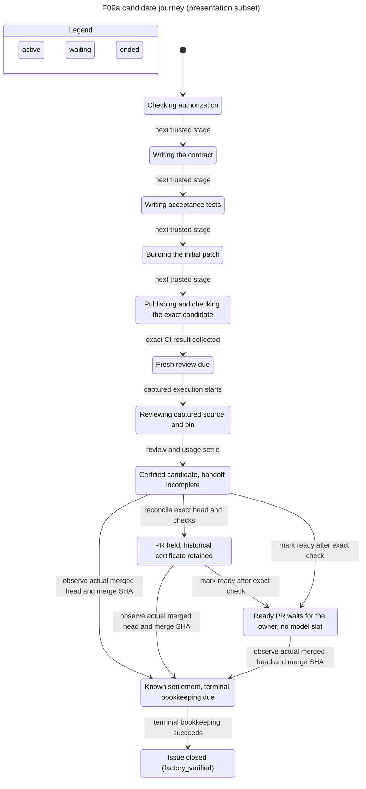

# F09a bounded state models

These models describe the candidate protocol at source commit `3af93bcff9b69d46dd7e0af3848bcd7e6edcedcc`. Structural and known-late Journey partitions completed. Duplicate unknown settlements expose a stop-to-finish counterexample in the real reducer; formal qualification is blocked. The substantive controller exploration did not complete. These are bounded control and token-accounting checks, not a proof of the whole factory or permission to merge a PR.

`Journey.tla` describes the shared `handoffCandidate` policy. `Controller.tla` instantiates Journey and adds claim persistence, external effects, captured callbacks, one restart and conditional validation-ref cleanup. It does not introduce another runtime candidate policy. F10 feedback repair is absent.

## Bounds and domains

All substantive configurations retain **6 total generations, 2 shared repairs, 3 run-wide refreshes and 3 issued review attempts per repair round**. A generation number is `0..3` within its round. The separate sequence index identifies one of the six retained entries. Early stages are a coarse prefix; their retry-5 behavior is checked by the actual runtime tests, not the structural partition.

| Coordinate | Finite model domain |
| --- | --- |
| Original repair base and admitted instruction pin | Separate named coordinates, both symbol `0` at admission |
| Certified source/main | `0..4`, including a fourth movement that must be refused |
| Candidate head and captured generation | Sequence identity `1..6` |
| Certification identity | Stored tuple of generation, execution, attempt, source, workflow pin, candidate, patch, CI, gate, acceptance and original base |
| Unexpected owner head | `99` |
| Actual merge commit | Distinct symbol `100 + mergedHead`, never the head itself |
| Observed account tokens | `0..UsageClass`, with `UsageClass = 1`; known and unknown are distinct |
| Prior-stage usage | `PriorUsage = 1` |
| Abstract review/repair/run quotas | `3 / 3 / 8` |
| Restarts | At most one in the controller check |
| Cleanup partition | One fixed `focus` generation chosen from `1..6` per behavior; all six identities are explored |

The accounting partition explores an exact certification tuple and each single-coordinate mismatch class. A mismatched tuple cannot certify the current generation. Workflow SHA/digest are one pinned identity class; cryptographic hashes and malformed wire types remain runtime boundaries.

The abstract quotas are not replacements for the unchanged real limits of **30,000 review tokens per round, 50,000 repair-build tokens per round and 500,000 run tokens**. There is no claim of linear scaling or a proof for all real amounts. Actual reducer tests check cap−1, cap and cap+1 at each real limit, cumulative attempts, prior-stage spend, duplicate/lower/unknown late results and oversized final receipts. Oversized usage is retained; it does not authorize another launch. Monetary accounting is not proved.

### Explicit partitions

The `Profile` constant selects a partition of the same model, not smaller structural constants.

- `structural`, in `journey/Journey.cfg`, permits CI-triggered repairs, successful repair builds, review success/failure and main movement during validation, review issuance, waiting or stopping. It excludes unknown usage, launch unavailability, switch/capacity changes, owner-head drift and blocking-review-triggered repair. It reaches all six generations.
- `accounting` uses the same Journey config with only `Profile` changed. It includes failed/unavailable attempts, blocking reviews, repair retries, unknown settlement and late accounting, but no main movement or switch/head-drift changes. With the default `LateUnknown = TRUE`, it exposes the counterexample below. A separate `LateUnknown = FALSE` check covers known late receipts and unknown current settlements only; its pass does not cover duplicate unknown old receipts.
- `late` is a diagnostic partition with successful CI and nonblocking known review results, main movement and both known/unknown late receipts. It also exposes stop-to-finish failure. It excludes unavailable launches and switch/head drift; it is not a combined proof.
- `transport`, in `controller/Controller.cfg`, includes successful or failed CI, successful repair builds, refresh, switch holds, owner head/merge/close, head lag, persistence, orphan stop and private-evidence loss. Review output is nonblocking; review/stop usage may still be unknown. It retains the six-entry path but excludes blocking-review repair, unavailable launches and failed repair-build retries.
- `CleanupPartition = TRUE` checks one representative generation's ref/deadline/owned cleanup per behavior. `focus` is chosen across all six identities and stays fixed. Other generations still take the shared candidate transitions, but their external ref/deadline substeps are abstracted. **Concurrent all-ref cleanup interleavings are unproved.** Setting it to FALSE represents the full ref cross-product; its exploratory check was stopped for growth, not accepted as a pass.
- `combined` enables the unpartitioned alternatives. Its exploratory run was stopped for state-space growth. **Composition of all faults is unproved.** Partition passes must not be called a full combined protocol proof.

No state-space constraint silently removes a seventh generation or a fourth issued review. Those refusals come from the policy. The actual six-entry runtime witness is `(r0,g0), (r1,g0), (r2,g0), (r2,g1), (r2,g2), (r2,g3)`. It uses only two repair executions before the final review, not an invented fourth review attempt.

## Checked properties

The configs are the exact property lists. These names replace the old F08 promises openly.

| Properties | Contract |
| --- | --- |
| `TypeOK`, `BookBounded`, `ExactBinding` | Legal finite domains, unchanged structural ceilings and captured generation/source/pin identity. |
| `ReviewOnlyValidated`, `CertificateSound`, `CertificationNeedsKnownSettlement`, `ReadyHasCertificate` | Review follows exact CI; certification is created from a known settled receipt and retains its immutable identity. Later accounting uncertainty does not erase historical certification. Historical certification is not current readiness. |
| `HandoffDecisionExact`, `PromotionDecisionExact` | At the observation that chooses the effect, readiness uses the current certified head and ordinary check; promotion starts from the expected predecessor. These are not omniscient assertions about later GitHub changes. |
| `MergeAssuranceTruthful` | Record the actual head and distinct merge commit. Matching historical certification gives `factory_verified`; an unmatched head gives `owner_override`. |
| `FinishOnlyAfterSettlement` | A stop completion that emits `finish_pr` must have reconciled every account. This action property currently fails. |
| `NoLiveTerminal`, `OneExecution`, `WaitingSlotFree`, `NoPostPrRepair` | No issued/running execution at termination, at most one issued/running execution, slot-free waiting and no post-PR feedback repair. Uncertain cost is distinct from a live execution. |
| `AllowanceWithinRemaining`, `NoFreshBudget`, `HistoryImmutable`, `UsageMonotonic`, `IssuedMonotonic` | Derived allowances, retained prior usage, immutable archives and monotonic account/attempt history. |
| `EffectHasDurableIntent`, `ProcessHasAccount`, `OneSandbox`, `NoTerminalProcess` | The controller persists before external work, binds the process to a saved account and never finalizes a live process. One process is represented explicitly; launch guards prevent another owner from reusing it. |
| `MissingGrantsNoWork`, `CleanupOwnedOnly`, `DeadlineNeverReset` | Missing private evidence grants no work; moved validation refs are preserved; generation deadlines never restart. |
| `SavedUsageMonotonic`, `SavedAttemptsMonotonic`, `SavedHistoryImmutable` | Atomic saved books retain their floors and archives across the modeled restart. |
| `ObservedMergeSettles` | An observed merge with known settled accounts and no live process eventually finishes, or visibly blocks on lost private evidence, under the scheduling/read assumptions below. |

The old `LandOnlyVerified` promise is false because an owner can merge an uncertified head. The replacement reports assurance honestly. The old instantaneous `MergeEndsRun` is replaced by observation, stop/account settlement and terminal bookkeeping. Clean review now leads to nonterminal waiting, not terminal `stage_passed`. Successful CI does not require an eventual owner merge.

### Fairness and proof limits

Journey has no fairness assumptions. Controller weak fairness covers `Persist`, `OtherResponse`, `RecoverStop`, `Recover`, `Decide` and `ObserveTerminal`. This assumes scheduled controller ticks and eventually successful required claim writes, owned-process reconciliation and response reads/effects when they remain enabled. The progress property starts after known settlement. It does not prove a permanently unresponsive process will stop or that unknown spend becomes known.

There is no fairness for owner merge, successful review, switch re-enable, capacity becoming free or restoration of private evidence. Missing-book PR observation remains visible, but cannot finalize without private accounting/certification. Private recovery represents a validated saved intent, not reconstruction from GitHub. Repeated arbitrary crashes are outside the one-restart bound.

Controller-only properties remain unproved because its substantive exploration did not complete. Cleanup is modeled per representative generation, not for every combination of all retired refs and restarts. The real all-generation sweeper tests remain required. Only one issue is modeled. The real Orchestrator test `waiting uses no slot while two other issues enter execution` retains capacity-2 coverage. Git object bytes, ordered parents, seat/risk schemas, full manifest parsing, marker size, filesystem atomicity and native Actions identity checks require runtime tests and separate qualification. Symbolic candidate identity denotes the final ordered-parent candidate prepared before CI; TLC does not implement Git hashing.

Effect completion represents an exactly matching domain request. Full JSON request equality and malformed/stale transport payload rejection remain runtime boundaries, not a formal parser proof. Promotion is a read, then `force:false`, then reread. It is **not expected-head CAS**. The controller model permits a different ancestor between the read and write, but refuses an unexpected nonancestor. Ref and API PR head are separate; the ordinary PR check follows promotion.

Local runtime probes found a recovery gap for conflicting evidence. An authenticated newer public marker can report 500001 tokens while a saved private book reports 40, and warm recovery accepts 40. A separate attempt-floor probe reports public attempt 3 but restores attempt 1. Preservation or refusal of those inconsistent books is **not proved and needs a separately authorized runtime fix**. Ordinary write-before-effect crashes have not been shown to create that conflict. No model-only refusal was added to conceal it.

### Stop-to-finish counterexample

The accounting and late diagnostic checks fail `FinishOnlyAfterSettlement` with exit 13. Their 14- and 19-state native traces match **10 and 15 actual intermediate candidate states**, respectively, through the exported reducer and public `advance`. The four coarse prefix transitions are excluded from that comparison; external actions leave the actual candidate unchanged until observation.

A late unknown result can make an older account uncertain after a newer execution has been issued. `finish` selects the first unsettled account. A known stop receipt for that account makes `complete` emit `finish_pr` without checking the other accounts. One trace retains an unknown repair account; the other retains an issued review. A separate actual reducer probe starts that newer review first and reaches `landed` with it still `running`.

These are concrete public-policy counterexamples, not a reproduced live controller incident. Delivery of the duplicate unknown event by the actual Orchestrator is unproved. No production source was changed; the fix requires separate authorization. The model does not add an absent `Drained` guard to `FinishPr` to hide the result. This blocks any full-protocol or PR-ready claim.

## Source correspondence

| Model actions/operators | Source at the sync commit |
| --- | --- |
| `Gen`, `Select`, `Issue`, `CanIssue`, `Account`, `Usage` | `src/handoff.ts`: `generationIntent`, `selectGeneration`, `issueExecution`, `preflight`, `updateAccount`, `candidateUsage` |
| `ReviewResult`, `Validate`, `FailOrRepair` | `handoffCandidate`, `complete`, `certifyGeneration`; full review/report validation is a boundary assumption backed by runtime tests |
| `Refresh`, `Handoff`, `ObserveMerge`, `Finish`, `Stop`, `FinishPr` | `src/handoff.ts`: `observed`, `terminalFor`, `finish`, `complete` |
| Shared public policy | `src/stages.ts`: `advance`; it delegates candidate events to `handoffCandidate` |
| `Decide`, `Persist`, effect/response separation | `src/orchestrator.ts`: `#observeCandidates`, `#commitCandidate`, `#interpretCandidate` |
| Process/captured callback/recovery actions | `#launchCandidate`, `#recoverCandidate`; callbacks capture their execution, and a new Orchestrator starts with an empty volatile result queue |
| Remote open/promotion and head lag | `server/controller.ts`: `controllerCandidatePort`; `src/publication.ts`: `GitHubPublicationApi.promotePr` |
| Fixed deadline and cleanup | `controllerValidator`, `sweepValidation`, `cleanupPublication`; original archived evidence is not rewritten |

Accounting records distinguish issued/running ownership from uncertain final cost. Historical certificates are checked at creation rather than being erased when a later receipt becomes uncertain. A stop request has a `stopping` phase, not slot-free `waiting`; `candidateProjection` reports such work as running. These are source-correspondence corrections, not passing substitutes for the failed stop-to-finish property. A pending finish after a queued callback alone is not proof of an unsafe external write: the actual Orchestrator observes again after consuming callbacks. Its stop-completion recursion is the boundary targeted here.

The earlier controller counterexample retained a volatile callback across a crash, then used it to certify a resumed live process. That step cannot occur in a new Orchestrator: `#candidateResults` is initialized per instance. The model was corrected to discard that queue on `Crash`; `NoTerminalProcess` was not weakened. No runtime bug is claimed from that trace.

## Results

TLC `2026.10.28.014557`, Temurin Java `21.0.13`, fingerprint polynomial `0`. Structural/counterexample checks use four workers, known-late accounting uses eight, the controller prefix uses four, and presentation checks use one. The model/config identities of these runs are SHA-256 values, separate from the runtime sync commit:

| File | SHA-256 |
| --- | --- |
| `journey/Journey.tla` | `4cec95e78856de97ac30c5cc19cbd19a87a5885dadda4403fd0eca5c052bd665` |
| `journey/Journey.cfg` | `f879e9902176b583becf6fcf9954c2ce3a463f851830b573d440cae5088a36ad` |
| `controller/Controller.tla` | `352119fe3afedc087573f0e44cf2031ed1d003c19f417dae538f0a04eab337bc` |
| `controller/Controller.cfg` | `ddc0cae91effbed82a890574c14f24b6af9abd5822532ea29465fb746b326bae` |

| Check | Distinct states | Outcome |
| --- | ---: | --- |
| Journey structural, full 6/2/3/3 | 1,670,069 | All configured properties hold |
| Journey accounting, known-late-only partition, same bounds | 4,568,906 | All configured properties hold; excludes duplicate unknown old receipts |
| Journey accounting, duplicate unknown receipts included | 700 before failure | `FinishOnlyAfterSettlement` fails, exit 13 |
| Journey late diagnostic | 7,980 before failure | `FinishOnlyAfterSettlement` fails, exit 13 |
| Controller transport, same structural bounds, one restart | 6,457,565 last reported | Incomplete; stopped with 1,189,118 states queued, exit 143 |
| Journey presentation | 42 | All configured properties hold |
| Controller presentation | 281 | All configured properties hold |

The controller stopped to reserve final gates and preservation time after repeated state-space growth. No violation was reported in that explored prefix, but its invariants and temporal properties are not claimed proved. The completed presentation check cannot substitute for it.

The presentation configs select a successful single-generation path with no refresh or restart and fix cleanup focus to generation 1. They are **not substantive proofs**, despite retaining the same ceiling constants. The diagrams come from their actual reachable graphs. The views hide no action explicitly; the renderer omits stuttering and transitions within the same displayed label. The full graphs exceed the renderer's 500-state budget and are not presented as these small diagrams.

The runtime correspondence entry point is a named-test runner, not a generic TLC decoder and not the obsolete F10 feedback-repair replay:

```sh
node --experimental-strip-types docs/statecharts/journey/replay-merge-mid-repair.ts
```

It requires a successful TAP result with at least 22 selected tests and named six-generation, real Orchestrator restart and actual promotion cases. The checked selection ran 26 tests. The six-entry TLC reachability witness also matched 14 actual intermediate candidate states through the exported reducer and public `advance`. Five isolated TypeScript mutations were caught: reset attempts on refresh, accept a stale generation, lower a usage floor, finish before stop and promote from an unexpected predecessor. Each mutated copy failed a behavior assertion; restoration passed. Unchanged TLC alone is not evidence against mutated TypeScript.

The final project gate includes all existing runtime tests. Formal checks, this runner and view compilation are separate from `npm run check`. Independent formal review, Comment Sicko, the complete crash/manifest/maximal-marker matrix, operator/rollout documentation, main-backed reporter bootstrap/P4, production protection, real owner actions and live/performance qualification remain separate gates. No full-feature or merge-ready verdict is implied.

## Presentation diagram

The matching standalone diagrams are [`journey/chart.mmd`](journey/chart.mmd) and [`controller/chart.mmd`](controller/chart.mmd).



## Reproduce the checks

The installed Node-first wrapper fails under Node 26. The direct Bun CLI loads, but this installed version's SANY XML reader also fails on standard-module CDATA comments with `undefined ... node.tag`. Removing CDATA in a diagnostic copy isolates that reader defect. Neither shared packages nor Java configuration was changed. No installer ran.

The normal entry remains the direct Bun script with both explicit environment paths. It currently fails before checking this model, so its exit is not a proof result:

```sh
export JAVA=/home/g/.local/share/mise/installs/java/temurin-21.0.13+9.0.LTS/bin/java
export TLA2TOOLS=/home/g/.local/share/tla/tla2tools.jar
SC=/home/g/.pi/agent/npm/node_modules/pi-herdr-pstack/skills/statechart/scripts/statechart.ts
bun "$SC" docs/statecharts/journey/Journey.tla --config docs/statecharts/journey/Journey.cfg --view docs/statecharts/journey/view.ts --out /tmp/f09a-journey-chart
```

The checked fallback invokes the same installed TLC jar directly. Journey and Controller must be colocated in a fresh scratch directory because Controller instantiates Journey:

```sh
OUT=$(mktemp -d)
cp docs/statecharts/journey/Journey.tla docs/statecharts/journey/Journey.cfg "$OUT/"
cp docs/statecharts/controller/Controller.tla docs/statecharts/controller/Controller.cfg "$OUT/"
(cd "$OUT" && "$JAVA" -Xmx3g -XX:+UseParallelGC -cp "$TLA2TOOLS" tlc2.TLC \
  -workers 4 -fp 0 -lncheck final -metadir meta-journey -config Journey.cfg Journey.tla)
(cd "$OUT" && "$JAVA" -Xmx4g -XX:+UseParallelGC -cp "$TLA2TOOLS" tlc2.TLC \
  -workers 8 -fp 0 -lncheck final -metadir meta-controller -config Controller.cfg Controller.tla)
```

The full accounting check changes only `Profile = "structural"` to `Profile = "accounting"` in a scratch copy of Journey.cfg. It currently exits 13 with the recorded counterexample, not a pass. The diagnostic uses `Profile = "late"`. The narrower known-late baseline additionally sets `LateUnknown = FALSE`; all structural bounds and properties remain unchanged. Its pass must never erase the failing default unknown-receipt case. Successful checks require exit 0 and a complete state queue; temporal properties, when present, must finish too. A partial exploration is not a pass.

For a presentation graph, use its `Chart.cfg`, one worker and `-dump dot,actionlabels graph`. The generated diagrams use the installed, unchanged renderer on that native DOT output. With `DOT`, `VIEW` and `CHART` set to absolute input/output paths, this is the rendering invocation:

```sh
export P=/home/g/.pi/agent/npm/node_modules/pi-herdr-pstack/skills/statechart/scripts
bun --eval '
const fs = await import("node:fs");
const { pathToFileURL } = await import("node:url");
const { inspect } = await import("node:util");
const load = (file) => import(`${process.env.P}/${file}.ts`);
const { parseDot } = await load("frontends/dot");
const { checkView } = await load("frontends/view");
const { walk } = await load("passes/reach");
const { project } = await load("pipeline");
const { mermaidLines } = await load("backends/mermaid");
const graph = parseDot(fs.readFileSync(process.env.DOT, "utf8"));
if (!graph.states.size || graph.states.size > 500) throw Error("presentation graph bound");
const view = checkView(await import(pathToFileURL(process.env.VIEW).href), inspect);
const { chart } = project(graph, walk(graph), view, []);
fs.writeFileSync(process.env.CHART, mermaidLines(chart).join("\n") + "\n");
'
```

This bypasses only the broken SANY XML/chart launcher, not TLC, its properties or its graph. No graph is hand-drawn.
